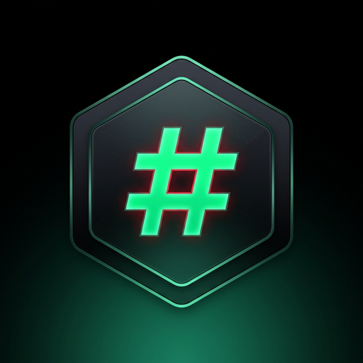

<p align="center">
  
</p>

<h1 align="center">Andarium Root</h1>

<p align="center">
  <b>Full-Root Android 17 (LineageOS 24) on iOS — Hardened StikDebug JIT, Native iOS Pre-Boot Studio, RE Workbench &amp; Stealth Lab.</b>
</p>

<p align="center">
  <a href="https://github.com/TotallyNotSantaKlaus/Andarium-Root-IPA/releases/latest"></a>
  <a href="https://github.com/TotallyNotSantaKlaus/Andarium-Root-IPA/actions/workflows/build-rooted-ipa.yml"></a>
  
  
</p>

Built on [imxieyi/Kernarium](https://github.com/imxieyi/Kernarium) (`Andarium-1.0-15.ipa`), **Andarium Root** turns iOS into a full-power rooted Android 17 playground — preserving GPU acceleration, audio, camera, and **hardened StikDebug JIT** while adding pre-boot hardware/slot controls and an on-device root & reverse-engineering suite.

---

## Install on iPhone

- **Direct Download**: Grab `Andarium-Root-1.0-15.ipa` (Full) or `Andarium-Root-Lite-1.0-15.ipa` from **[Releases](https://github.com/TotallyNotSantaKlaus/Andarium-Root-IPA/releases/latest)**.
- **SideStore / AltStore / Feather Source** *(1-tap updates)*:
  ```text
  https://raw.githubusercontent.com/TotallyNotSantaKlaus/Andarium-Root-IPA/main/docs/altstore-source.json
  ```

### Enable JIT in 3 Steps
1. Install the IPA via **SideStore / AltStore / Feather / Sideloadly** *(on **LiveContainer**, enable **Helper Process Support**)*.
2. Install **StikDebug 2.3.x+** *(auto-selects `universal.js` out of the box; manual copy in [`docs/stikdebug-universal.js`](docs/stikdebug-universal.js))*.
3. Open **Andarium Root** from **StikDebug** — or tap **`# Setup · ⚡ JIT → Enable JIT via StikDebug`** inside the app.

---

## Highlights

- **⚡ Hardened StikDebug JIT Engine**: StikDebug `universal.js` auto-script matching, 36-bit `<64 GiB` address-truncation shield, fresh-install auto-arming, soft-`mlock()` fallback for free Apple IDs, and a live **JIT Doctor** (`CS_DEBUGGED` / `CS_KILL` / RAM / TXM / runtime logs).
- **🎛️ Native iOS Pre-Boot Studio (`# Setup`)**: Switch **Multi-VM Slots** (isolated disks & profiles), tune vCPUs, RAM, disk size, retina scale, anti-thermal throttle, FPS HUD, root ON/OFF, spoof profile, and presets *before* Android boots.
- **🔓 Magisk v31.1 + Stealth Stack**: ReZygisk, Vector (LSPosed for Android 17), PlayIntegrityFork, TrickyStore (`keybox.xml` + `target.txt` UI), Zygisk-Assistant, native `adb root`, and reversible root hiding.
- **🧪 On-Device RE & Network Lab**: Standalone `frida-inject` + `frida-server` + 5 bypass scripts, `tcpdump` PCAP recorder, SQLite/SharedPrefs inspector, per-app root firewall, transparent MITM proxy (`iptables`), Private DNS, Dropbear SSH, and systemless ad-block.
- **📱 Device / 120 FPS Spoofer & Control Panel v5**: 6 boot-time device profiles (Pixel 9 Pro, S25 Ultra, ROG Phone 9 Pro 120 FPS, RedMagic 10 Pro, Xiaomi 15 Ultra), safe LineageOS debloater, macros & scheduler — all controlled at `127.0.0.1:8787` (or via Magisk → Action).

---

## Role Presets

| Preset | Theme | Default Spoof | Best For |
| --- | --- | --- | --- |
| **`mix`** | DuskJade | Stock | Everything enabled — Magisk, LSPosed, Stealth, Frida, SSH, all 13 APKs |
| **`seceng`** | Crimson | Stock | Mobile AppSec — Frida + SSH autostart, MITM CA sync, TrustMeAlready, FLAG_SECURE bypass |
| **`hacker`** | Crimson | Stock | Maximum RE — `frida-inject`, `strace`/`tcpdump`/`socat`, `0x` animations, `360 DPI` |
| **`gamer`** | Cyber | **ROG 9 Pro (120 FPS)** | Anti-cheat Stealth + Enforcing SELinux, `0x` animations, `swappiness=130`, zero daemons |
| **`privacy`** | Stealth | **Pixel 9 Pro** | Clean daily Android 17 — microG, Aurora Store, Obtainium, Ad-Block, Stealth ON |
| **`unrooted`** | Stealth | Stock | Hidden root (reversible in `# Setup`) — or `-NoRoot` for stock `init_boot.img` |

---

## Build Locally (Windows + WSL2 / Linux)

```powershell
.\studio.ps1                         # Interactive Web Builder Studio (http://127.0.0.1:8765)
.\build.ps1 -Preset mix              # Build & independently verify IPA (30+ checks)
.\build.ps1 -Preset gamer -Spoof rog9 -IconTheme cyber
.\companion.ps1 -Connect <ip>:5555 -Action webui   # Control Panel over ADB
.\update.ps1 -Apply                  # Check & update pinned upstream releases
```

Drop custom `.apk`s, Magisk `.zip`s, Burp/mitmproxy CA certs, `keybox.xml`, or boot scripts into [`custom/`](custom/README.md) to bake them straight into your build.

---

## License

Builder tooling and guest scripts are licensed under **GPL-2.0-or-later** (matching Kernarium's image tooling). Bundled upstream apps and modules retain their respective open-source licenses.
